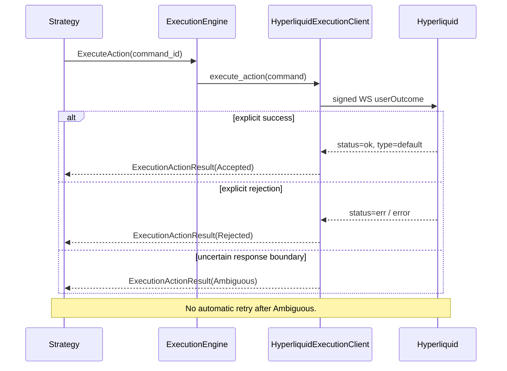

# Execution Actions: HIP-4 Split and Merge

This design records the smallest shared execution-lifecycle extension used to route
Hyperliquid HIP-4 `userOutcome` actions from a strategy and return a correlated delivery result.

The first live milestone implements the scope discussed in
[issue #5286](https://github.com/nautechsystems/nautilus_trader/issues/5286): Hyperliquid
`splitOutcome` and `mergeOutcome`.

## Decision

Introduce one correlated, non-order command/result pair:

- `ExecuteAction`: a strategy-owned command that asks an execution client to perform a namespaced
  venue action.
- `ExecutionActionResult`: a correlated delivery result, delivered only to the initiating strategy
  when the active client generation observes a terminal post outcome.

The initial Hyperliquid allow-list is intentionally narrow:

| Action                           | Parameters                                | Venue operation |
| -------------------------------- | ----------------------------------------- | --------------- |
| `hyperliquid.user_outcome.split` | `outcome: u32`, `amount: Decimal`         | `splitOutcome`. |
| `hyperliquid.user_outcome.merge` | `outcome: u32`, `amount: Option<Decimal>` | `mergeOutcome`. |

The command envelope is common; payloads remain adapter-owned. No
`ExecutionActionSettlement`, synthetic order, or synthetic fill is introduced.

## First live milestone

The first milestone is one narrow, end-to-end Hyperliquid live slice. Its purpose is to
give a strategy a correlated delivery result for `splitOutcome` or `mergeOutcome`; it does not
model an inventory conversion in the engine.

| Included                                                                                        | Deliberately deferred                                                               |
| ----------------------------------------------------------------------------------------------- | ----------------------------------------------------------------------------------- |
| Common `ExecuteAction` and `ExecutionActionResult` messages, serialization, and Python exports. | Simulation of split/merge cash, fees, or positions.                                 |
| Strategy submission and `on_execution_action_result` callback routing.                          | A common `OutcomeId`, `MarketId`, or cross-venue pair resolver.                     |
| Hyperliquid live decoding, signing, submission, and result classification.                      | A generic blockchain-action abstraction or action-specific engine logic.            |
| Explicit safe rejection by unmodelled sandbox/backtest clients.                                 | Synthetic orders, fills, account updates, or position updates from the post result. |

The implementation follows this ownership boundary:

```text
strategy
  -> ExecuteAction(action, adapter-owned params)
  -> ExecutionEngine routes only by client/account
  -> HyperliquidExecutionClient interprets the action and sends userOutcome
  -> ExecutionActionResult returns only to the originating strategy

Hyperliquid private state/reconciliation
  -> existing account, fill, and position flows
```

`outcome: u32` is a Hyperliquid parameter, not a shared market identifier. The live client forwards
it directly to the venue. It must not derive Yes/No `InstrumentId`s or read Cache state on this
path. A future venue uses its own action name and parameters: for example, a condition or token
identifier rather than assuming Hyperliquid's numeric outcome encoding.

### Implementation path

1. The command/result pair is part of the common execution-message surface, including all supported
   serializers and generated Python surface. The result carries the original `command_id`, strategy,
   client, account, action, status, reason/info, and event timestamp.
2. The engine routes the command and delivers the result to its strategy. A missing client, an
   unsupported client, or an external
   client that cannot provide a correlated result returns one `Rejected`; the command does not enter
   order routing, risk, execution algorithms, or the order emulator.
3. `ExecutionEvent::Action` is a pass-through event. Live-node dispatch publishes it to the
   initiating strategy but does not involve the order manager, reconciliation order state, or fill
   processing.
4. One `ExecutionClient::execute_action` entry point has one Hyperliquid implementation. The
   adapter allow-list decodes the two names above, builds the existing typed wire action, and uses
   the established post-command boundary so pre-send, explicit venue rejection, and ambiguous
   post-send outcomes remain distinguishable. It uses the client task lifecycle so stop, reset,
   and disposal cannot emit a late result from an earlier generation.
5. Unmodelled sandbox and backtest execution explicitly returns a correlated `Rejected` with no
   state mutation. This prevents a new public command from panicking or succeeding silently while
   the separate simulation milestone remains unimplemented.

Controlled testnet recordings remain required before asserting natural state convergence. A
recording must distinguish the synchronous WebSocket post response from later account, fill,
position, and reconciliation messages.

This is a single coherent change: do not land a public action envelope without its one production
consumer and its safe simulated-client behaviour.

## Why split and merge are not orders

Directional Yes/No trades already use `SubmitOrder` on `BinaryOption` and retain the normal
order, risk, fill, and position lifecycle. A split or merge is an inventory conversion:

| Operation | Venue effect                           | What does not exist                               |
| --------- | -------------------------------------- | ------------------------------------------------- |
| Split `A` | Quote `A` becomes `A` Yes plus `A` No. | Order ID, order state machine, single-sided fill. |
| Merge `A` | `A` matched Yes/No pairs become quote. | Order ID, order state machine, single-sided fill. |

Hyperliquid documents the successful response as:

```json
{"status":"ok","response":{"type":"default"}}
```

It has no action ID, fill, balance, fee, or resulting inventory. It proves only that Hyperliquid
accepted the signed request. It must not create `OrderAccepted`, `OrderFilled`, `FillReport`,
`AccountState`, or a position event.

## Live delivery and observed state

### Command and result

The public strategy surface is:

```text
strategy.execute_action(account_id, action, client_id=None, params=None) -> command_id
strategy.on_execution_action_result(result)
```

`ExecuteAction` owns the normal trader, strategy, account, and client context; a generated
`command_id`; the fully qualified action; adapter-owned `Params`; and command timestamps and
correlation metadata. `ExecutionEngine` routes it directly to
`ExecutionClient::execute_action`. It does not enter the order emulator, execution algorithms, or
the order-specific risk path.

`ExecutionActionResult` contains `command_id`, ownership/client context, action, delivery status,
a sanitized reason, optional stable `info`, and `ts_event`.

| Status      | Evidence                                                                                     | Strategy obligation                            |
| ----------- | -------------------------------------------------------------------------------------------- | ---------------------------------------------- |
| `Accepted`  | Decoded `status: "ok"` and `response.type: "default"`.                                       | Await ordinary venue state updates.            |
| `Rejected`  | Request definitely was not sent, or the venue explicitly returned `status: "err"` / `error`. | Treat as not applied under available evidence. |
| `Ambiguous` | The request may have reached the venue, but no definitive response exists.                   | Do not automatically retry.                    |

`Ambiguous` has the same evidence meaning as `CommandFailure::Ambiguous`. It is emitted for a
request timeout or another post-write uncertain transport result observed by the active client
generation. It is the final **delivery notification** for that observed outcome, not an economic
terminal state or a rejection. The strategy must not blindly retry it, but continues to receive
ordinary account, position, and reconciliation updates. A later, uncorrelated update must not be
treated as the action's success or cause a second action result: `userOutcome` has no venue action
ID, while account and outcome-token balances are aggregate state that may also change through
another strategy, a manual action, or ordinary trading.

The `QueryAccount` / `QueryOrder` comparison is deliberately narrow. Queries have no correlated
ACK: the engine only accepts their local scheduling, and any later account state or order report is
an independent observation. They also do not fabricate a query callback when cancellation ends
their work.

An action is different because it is a strategy-initiated venue write. It requires one correlated
`ExecutionActionResult` ACK for a local rejection or an outcome actually observed by the active
client generation. Once its asynchronous delivery has been admitted, lifecycle cancellation uses
the same narrow query rule: an action task cancelled because its client stops, disconnects, resets,
or disposes does not fabricate a callback. The next client generation relies on its ordinary
account, fill, position, and reconciliation flows. A process crash has no in-process consumer at
all.

### Live path

The live path is latency-sensitive. It signs and sends the typed `userOutcome` action without
synchronously checking cached balance, Yes/No inventory, expiry, pairing, or fees. Those views can
be stale; an explicit Hyperliquid response decides those business conditions.

Only evidence proving no request was sent produces a local rejection: an unencodable command,
unavailable credentials/signer, an unresolvable required `outcome` identifier, or a client known
unusable before transmission. This is command construction/routing, not local inventory or risk
validation.

For this classification, "before dispatch" ends at the WebSocket writer, not at the internal
`HandlerCommand::Post` queue. Enqueuing a handler command is only local scheduling. A handler-side
serialization failure, absent writer, or a network `SendError` that proves no write began remains
`Rejected`; only a completed or indeterminate write followed by a missing/invalid venue response
is `Ambiguous`.



| Scenario                                                                                                                                | Action result |
| --------------------------------------------------------------------------------------------------------------------------------------- | ------------- |
| The action name or parameters cannot be encoded.                                                                                        | `Rejected`.   |
| No client routes the command, the client does not support it, or its task group no longer admits work.                                  | `Rejected`.   |
| The WebSocket post fails before dispatch.                                                                                               | `Rejected`.   |
| Hyperliquid explicitly returns `err` or `error`.                                                                                        | `Rejected`.   |
| Hyperliquid returns `ok` with `response.type: default`.                                                                                 | `Accepted`.   |
| A timeout, connection loss, 429/5xx, response-channel closure, response-decoding failure, or unexpected response occurs after dispatch. | `Ambiguous`.  |
| Client stop, disconnect, reset, or disposal cancels an old-generation task.                                                             | No result.    |
| The process crashes.                                                                                                                    | No result.    |

Lifecycle cancellation is not post-response evidence. It closes the current task generation and
suppresses old completions; it must neither fabricate `Ambiguous` nor leak a late result into a
new generation. A request encoding/signing failure is `Rejected`; a structured venue error is also
`Rejected`.

The result and observed state have separate clocks:

```text
strategy -> ExecuteAction -> execution client -> userOutcome
                                            <- ExecutionActionResult

venue userEvents/userFills/reconciliation -> AccountState/fills/positions
                                          -> existing portfolio and strategy callbacks
```

The adapter combines `clearinghouseState` and `spotClearinghouseState` for account snapshots.
`spotState` is a venue balance-snapshot subscription, not the current strategy-state source.
Testnet recordings must prove the post-action `userEvents`, `userFills`, fee fields, timing, and
external-fill reconciliation before claiming that split/merge naturally converge to live
`BinaryOption` positions.

Do not add a `split` provenance tag to positions. Split-minted and normally purchased side tokens
are fungible in a net position.

### External message-bus observation

`ExecutionActionResult` is also published to external message-bus egress using the typed
`ExecutionActionResult` payload and the existing JSON or MessagePack policy. This is an
observation/audit integration point: the receiving system chooses any durable storage and must
preserve the distinction between `Accepted`, `Rejected`, and `Ambiguous`.

It is deliberately **egress-only**. An externally received `ExecutionActionResult` is ignored
before typed processing or local republishing, even when external streaming is enabled. An action
result represents local execution-client delivery evidence, so accepting an inbound value would
allow an external producer to impersonate a venue acknowledgement and invoke a strategy callback.

## Second milestone: sandbox and backtest design

The first milestone is live-only. A generic sandbox/backtest client which does not model
the action returns one correlated `Rejected` and changes nothing.

When simulation support is added, strategy behavior remains:

```text
ExecuteAction
  -> simulated execution client
  -> split or merge transition
  -> existing position and account updates
  -> ExecutionActionResult
```

### Configuration and fees

Do not make split/merge an automatic property of every `BinaryOption`. A binary-option simulator
must explicitly opt into outcome-action support; venue action names and conversion semantics remain
adapter-owned.

The enabled simulator has one immutable binary-option outcome-action configuration:

```text
split_notional_rate
merge_notional_rate
rounding
fee_currency = quote
```

For quote notional `A`, operation `op`, selected rate `r_op`, and quote-currency rounding `R_q`:

```text
F_op = R_q(A × r_op)
```

This supports fees for either operation. Hyperliquid's current configuration is
`r_split = 0` and `r_merge = taker_rate`; another venue can set both rates without changing the
shared command or generic `FeeModel`.

`FeeModel` is not reused because its contract requires an `Order`, fill quantity, fill price, and
instrument. Split/merge have no order or fill.

For a quote-currency fee charged in addition to conversion:

| Operation | Position deltas                | Quote delta       |
| --------- | ------------------------------ | ----------------- |
| Split `A` | Yes `+A @ 0.5`; No `+A @ 0.5`. | `-(A + F_split)`. |
| Merge `A` | Yes `-A`; No `-A`.             | `+(A - F_merge)`. |

### Two validation scopes

The simulator is the venue. Its correctness checks have only two scopes.

1. **Initialization or registration, once.** Validate that binary-option outcome-action simulation
   is enabled, its immutable fee configuration is valid, and the configured account/OMS model
   supports quote-cash accounting and netting. A malformed enabled configuration fails
   construction/registration. An unconfigured client is unsupported and returns `Rejected`.
2. **At every action's effective simulated time.** After normal submission/insert latency and FIFO
   scheduling, resolve the pair from the current Cache and validate every mutable fact.

There is no instrument-load validation phase. A pair registry built when instruments load may be an
invalidated lookup optimization only; it cannot replace resolving both legs from the current Cache.
Unsubscribing market data normally need not evict an instrument from Cache, but if a
sandbox/backtest scenario has removed either leg, the action is rejected at its effective time.

| Runtime check          | Split `A`                                                                                                    | Merge `A` / `None`                                                                   | On failure               |
| ---------------------- | ------------------------------------------------------------------------------------------------------------ | ------------------------------------------------------------------------------------ | ------------------------ |
| Command and arithmetic | `A` is positive, finite, representable at current quantity precision; fee/cash delta does not overflow.      | Same; `None` resolves to current maximum mergeable quantity.                         | `Rejected`; no mutation. |
| Current Cache topology | Cache has exactly one supported Yes/No pair with compatible outcome/question, quote currency, and precision. | Same.                                                                                | `Rejected`; no mutation. |
| Current lifecycle      | Both cached legs are active at effective time and neither is expired nor settled.                            | Same.                                                                                | `Rejected`; no mutation. |
| Current account state  | Configured cash/netting account is present and usable.                                                       | Same.                                                                                | `Rejected`; no mutation. |
| Available inventory    | Free quote is at least `A + F_split`.                                                                        | Free Yes and No are each at least `A`; `None` requires `min(free_yes, free_no) > 0`. | `Rejected`; no mutation. |
| Legal transition       | Both position opens/updates and quote debit are representable.                                               | Both reductions/closes and quote credit are representable.                           | `Rejected`; no mutation. |

Submission-time state checks are incorrect: an earlier scheduled order/action may alter Cache
membership, cash, inventory, or settlement state before this action becomes effective.

### Atomic simulated transition

Two concrete handlers are sufficient:

```text
handle_split_outcome(command)
handle_merge_outcome(command)
```

Each resolves current state, calculates the applicable fee, builds both position deltas and the
cash delta, validates the complete transition, and commits it atomically. There is no partial
split, merge, or fee debit.

The private engine seam updates positions with existing accounting rules and publishes only the
existing `AccountState`, `PositionOpened`, `PositionChanged`, and `PositionClosed` events. It must
not fabricate an `OrderFilled`, `FillReport`, order ID, or public settlement event. Publish those
state events before `ExecutionActionResult::Accepted`, so the strategy observes consistent Cache
and portfolio state in its action callback.

Normal deterministic simulation produces `Accepted` or `Rejected`, never `Ambiguous`. A process or
invariant failure whose commit status is unknowable fails the run rather than publishing an
invented ambiguous result. Reset/stop discards delayed, uncommitted actions and cannot leak a
result into a later client generation.

Initial support is netting OMS only. Hedging mode needs an explicit venue-faithful rule for the two
position IDs consumed by merge.

## Required proof

Before declaring the live patch complete:

1. Test command serde, engine routing, ownership, result delivery for each observed terminal post
   outcome, and Rust/Python callback dispatch.
2. Test Hyperliquid `ok/default`, explicit error, malformed response, timeout, and post-dispatch
   transport failure. Assert none creates a synthetic order, fill, account, or position event.
3. Prove stop, disconnect, reset, and disposal suppress old-generation results rather than emit a
   stale or duplicate callback.
4. Replay controlled testnet split/merge recordings through production parsers and establish how
   subsequent venue state becomes both `BinaryOption` positions.

Before declaring sandbox/backtest support:

1. Test initialization rejects malformed enabled configurations.
2. Test full/partial merge and `merge(None)`; independent non-zero split/merge rates; rounding;
   precision; and overflow.
3. Test missing or mismatched current-Cache pair, expiry/settlement, account absence, insufficient
   quote, and insufficient Yes/No. Each rejection must leave both positions and cash unchanged.
4. Test exact cash, fee, quantity, realized PnL, remaining basis, state-event-before-result order,
   latency/FIFO behavior, and reset of delayed actions.

## Non-goals

- Supporting `mergeQuestion` and `negateOutcome` in the initial allow-list.
- Replacing the low-level Hyperliquid HTTP helpers.
- Routing action commands through the risk engine, order emulator, or execution algorithms.
- Emitting order events, faking fills, or mutating state from a live post result.
- Treating `spotState` as proof of position reconstruction.
- Designing a generic blockchain-action framework before another real adapter needs one.

## References

- [Hyperliquid `userOutcome` exchange actions](https://hyperliquid.gitbook.io/hyperliquid-docs/for-developers/api/exchange-endpoint#useroutcome).
- [NautilusTrader Hyperliquid integration guide](../integrations/hyperliquid.md#hip-4-outcome-markets).
- [NautilusTrader adapter execution contracts](adapters.md#execution-and-reconciliation).
- [RFC issue #5286](https://github.com/nautechsystems/nautilus_trader/issues/5286).

## 中文审阅版

本节与前文的英文设计稿表达同一方案，供设计审阅使用；实现与代码注释仍以英文为准。

### 结论

HIP-4 split/merge 是 inventory transformation，不是订单。策略发送 `ExecuteAction`；当前 client
generation 观察到终态 post 结果时才返回 `ExecutionActionResult`。交易所后续的账户、成交与仓位状态仍沿用既有
`AccountState`、fill 和 position 流程。

第一期 action：

| Action                           | 参数                                        | 对应操作            |
| -------------------------------- | ----------------------------------------- | --------------- |
| `hyperliquid.user_outcome.split` | `outcome: u32`、`amount: Decimal`。         | `splitOutcome`。 |
| `hyperliquid.user_outcome.merge` | `outcome: u32`、`amount: Option<Decimal>`。 | `mergeOutcome`。 |

不能伪造 `OrderAccepted`、`OrderFilled`、`FillReport`、账户或仓位事件。WS post 的
`ok/default` 只证明交易所接受签名请求，未提供 action ID、fill、fee 或最终余额。

### 第一里程碑：Hyperliquid 实盘接入

第一期是一个窄而完整的实盘纵向切片：策略可获得 `splitOutcome` 或 `mergeOutcome` 的关联
delivery result，但引擎不模拟 inventory conversion。

| 纳入范围                                                         | 明确不在本期                                            |
| ------------------------------------------------------------ | ------------------------------------------------- |
| 公共 `ExecuteAction` / `ExecutionActionResult`、序列化与 Python 导出。 | split/merge 的模拟现金、fee 或仓位。                        |
| 策略提交以及 `on_execution_action_result` 回调路由。                    | 公共 `OutcomeId`、`MarketId` 或跨 venue pair resolver。 |
| Hyperliquid 实盘解码、签名、提交与结果分类。                                 | 通用 blockchain-action 框架或 action 专用的 engine 语义。    |
| 未建模 sandbox/backtest client 的安全拒绝。                           | 由 post 结果伪造订单、fill、账户或仓位更新。                       |

职责边界如下：

```text
strategy
  -> ExecuteAction(action, adapter-owned params)
  -> ExecutionEngine 仅按 client/account 路由
  -> HyperliquidExecutionClient 解释 action 并发送 userOutcome
  -> ExecutionActionResult 仅回到发起策略

Hyperliquid 私有状态流与 reconciliation
  -> 现有 account、fill、position 流程
```

`outcome: u32` 是 Hyperliquid 参数，不是公共 market identifier。实盘 client 直接将它传给
venue，不应在该路径推导 Yes/No `InstrumentId` 或读取 Cache。未来其他 venue 应持有自己的 action
名称与参数，例如 condition 或 token identifier，不能假设 Hyperliquid 的数字编码。

第一里程碑的实现路径如下：

1. 在公共 execution-message surface 增加命令/结果及全部序列化、Python generated surface。
2. 增加 engine 路由和策略投递；缺失 client、不支持的 client，或无法提供关联结果的 external
   client 均一次性返回 `Rejected`，且不进入订单、risk、execution algorithm 或 order emulator。
3. 增加只作转发的 `ExecutionEvent::Action`；live node 将其投递给发起策略，但不经过
   order manager、订单 reconciliation 或 fill 处理。
4. 增加唯一的 `ExecutionClient::execute_action` 与 Hyperliquid 实现。adapter allow-list 只解析
   前述两个名称，构造既有 typed wire action，并走已有 post-command boundary，以区分发送前失败、
   venue 明确拒绝和发送后不确定；它必须纳入 client task lifecycle，使 stop、reset、dispose 后不会
   从旧 generation 发送迟到结果。
5. 未建模的 sandbox/backtest 显式回传关联 `Rejected` 且零状态变更，避免新公共命令 panic 或静默成功。

在主张状态能够自然收敛前，仍需录制可控 testnet split/merge；录制应区分同步 WS post 回应与随后到达的
account、fill、position、reconciliation 消息。

这是一个完整的单一变更：公共 action envelope 不应脱离其首个 production consumer 和安全的模拟端行为。

### Live 语义

策略接口为：

```text
strategy.execute_action(account_id, action, client_id=None, params=None) -> command_id
strategy.on_execution_action_result(result)
```

结果是一次 delivery notification，不等于经济终态：

| 状态          | 证据                                               | 策略含义                 |
| ----------- | ------------------------------------------------ | -------------------- |
| `Accepted`  | 已解析 `status: "ok"` 与 `response.type: "default"`。 | 等待正常 venue state 更新。 |
| `Rejected`  | 能证明请求未发出，或 venue 明确返回 `status: "err"` / `error`。 | 在现有证据下未生效。           |
| `Ambiguous` | 请求可能到达 venue，但没有确定响应。                            | 不自动重试。               |

live 为降低延迟不检查缓存余额、Yes/No 库存、到期、pair 或 fee，也不在关键路径同步
`QueryAccount`。这些可能过期的业务条件一律由 Hyperliquid 的显式响应裁决。

这里的“发送前”以 WebSocket writer 为边界，不是 adapter 内部成功写入
`HandlerCommand::Post` 队列。入队仅代表本地调度成功：handler 侧序列化失败、没有 writer，或 network
`SendError` 能证明尚未开始写帧时，仍是 `Rejected`；仅当写入已经完成或无法证明未写入，随后又缺少/无法解析
venue 响应时，才是 `Ambiguous`。

`QueryAccount` / `QueryOrder` 的类比只限于 lifecycle：查询没有关联 ACK，engine 只接受其本地调度，随后
账户状态或订单报告是独立观察；查询任务被取消时也不会伪造 query callback。

`ExecuteAction` 不同：它是策略主动发起的 venue 写请求，必须有一个关联 `command_id` 的
`ExecutionActionResult` ACK，表示本地拒绝或活动 client generation 实际观察到的 venue 结果。它一旦已经
进入异步投递，client stop、disconnect、reset、dispose 导致 task generation 取消时，才遵循与查询相同的
窄生命周期规则：不伪造 callback。下一代 client 依靠既有账户、fill、仓位与 reconciliation 流程恢复事实状态。
进程崩溃时没有存活消费者，同样没有结果。

| 场景                                                            | ActionResult |
| ------------------------------------------------------------- | ------------ |
| action 名称或参数无法编码。                                             | `Rejected`。  |
| 无可路由 client、client 不支持 action，或 TaskGroup 不再接纳任务。             | `Rejected`。  |
| WS post 在发送前失败。                                               | `Rejected`。  |
| Hyperliquid 明确返回 `err` / `error`。                             | `Rejected`。  |
| Hyperliquid 明确返回 `ok` + `response.type: default`。             | `Accepted`。  |
| 已发送后 timeout、断链、429/5xx、响应通道关闭、响应解析失败或异常响应。                   | `Ambiguous`。 |
| client stop、disconnect、reset、dispose 导致旧 generation task 被取消。 | 不发送结果。       |
| 整个进程崩溃。                                                       | 不发送结果。       |

`Ambiguous` 只表示活动 client generation 实际观察到的发送后不确定结果；task lifecycle cancellation
不是 post-response 证据。它必须抑制旧 generation 的迟到结果，不能伪造 `Ambiguous` 或泄漏到新
generation。它不是 reject：策略不应盲目重试，但仍继续接收正常账户、仓位与 reconciliation 更新。随后
无关联的账户/仓位更新既不能被当作该 action 成功，也不能再生成第二个 action result；`userOutcome` 没有
venue action ID，而账户及 outcome token 余额都是聚合状态，也可能由其他策略、手工操作或正常交易改变。

请求编码/签名失败、缺少凭据、无法取得必需 `outcome`、或发送前确定 client 不可用，才是本地
`Rejected`。

`clearinghouseState` 与 `spotClearinghouseState` 是当前账户快照来源。`spotState` 只是 venue
余额快照订阅，不是当前策略状态来源。仍需用 testnet 录制证明 split/merge 后的
`userEvents`、`userFills` 与对账数据会如何自然收敛为两边 `BinaryOption` 仓位。

### Sandbox/backtest

未建模 action 的通用 sandbox/backtest client 返回一次 `Rejected`，不改变状态。已启用的
binary-option outcome-action simulation 不意味着所有 `BinaryOption` 自动支持 split/merge；
每个 venue/simulator 必须显式启用并拥有自己的 action 名称与转换语义。

费用配置是不可变的：

```text
split_notional_rate
merge_notional_rate
rounding
fee_currency = quote
```

设 quote notional 为 `A`、操作费率为 `r_op`、quote 精度舍入为 `R_q`：

```text
F_op = R_q(A × r_op)
```

这允许 split 与 merge 都收费。Hyperliquid 当前只是 `r_split = 0`、
`r_merge = taker_rate` 的一个配置。不能复用订单 `FeeModel`，因为 split/merge 没有 order 或 fill。

模拟业务校验只有两个时机：

1. **初始化/注册时一次。** 校验已启用 binary-option outcome-action simulation、费率/rounding/币种
   配置完整合法、账户/OMS 模型支持 quote cash 与 netting。已启用但配置错误时构造或注册失败；
   未启用的 client 仍是 unsupported，收到 action 后回传 `Rejected`。
2. **每个 action 的实际生效时刻。** 经既有 latency/FIFO 后，从当前 Cache 重新解析 Yes/No pair，
   再校验全部可变状态。

没有“instrument 加载时一次”的业务校验阶段。加载时构建的 pair 索引最多是可失效的查询加速，不能代替
action 生效时检查当前 Cache；若模拟场景中任一腿已被移出 Cache，则 `Rejected`。市场数据退订本身通常
不应移除 Cache 内的可交易 instrument。

| 生效时检查         | split `A`                                                  | merge `A` / `None`                       | 失败结果            |
| ------------- | ---------------------------------------------------------- | ---------------------------------------- | --------------- |
| 命令与数值         | `A` 为正、有限且符合当前精度；fee/cash delta 不溢出。                       | 相同；`None` 取当前可 merge 的最大值。               | `Rejected`，零变更。 |
| 当前 Cache pair | 存在唯一受支持的 Yes/No pair；outcome/question、quote currency、精度兼容。 | 相同。                                      | `Rejected`，零变更。 |
| 当前生命周期        | 两腿在生效时均有效，未到期、未结算。                                         | 相同。                                      | `Rejected`，零变更。 |
| 当前账户          | 配置的 cash/netting account 存在且可用。                            | 相同。                                      | `Rejected`，零变更。 |
| 可用库存          | free quote `>= A + F_split`。                               | free Yes 与 No 都 `>= A`；`None` 时最小值必须大于零。 | `Rejected`，零变更。 |
| 合法变更          | 两边仓位建仓/更新与 quote 扣减可表示。                                    | 两边减仓/平仓与 quote 增加可表示。                    | `Rejected`，零变更。 |

提交时由 `handle_split_outcome(command)` 或 `handle_merge_outcome(command)` 计算费用，先构造并完整验证
两个仓位和现金 delta，再原子提交。不得出现部分 split、部分 merge 或部分扣费。先发布既有
`AccountState` 和 position events，再发送 `Accepted`，保证策略回调看到一致的 Cache/portfolio。

确定性 sandbox/backtest 只产生 `Accepted` 或 `Rejected`，没有 `Ambiguous`。若引擎连事务是否提交都无法
确定，应使运行失败，而不是构造一个未知结果继续运行。reset/stop 丢弃尚未生效的延迟 action，且不得向
新的 client generation 泄漏旧结果。

首版只支持 netting OMS；hedging mode 的 merge 必须先制定符合 venue 的 position-ID 消耗规则。
